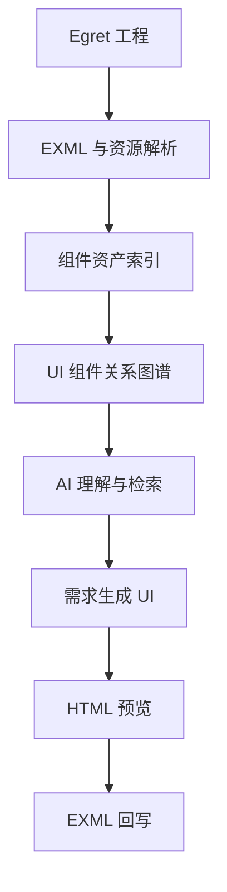

# P2 规划：工程级 UI 资产索引与 AI UI 工作台

- 日期：2026-11-05
- 状态：**P2 已关闭（P2-A/B/C/D/E 全部完成，提交 0dc2034 / e80c8d6 / 68f0495 / f319fbe / 8bff5a3，CI 全绿）**
- 定位：从「单个目标页面渲染成功」推进到「整个 Egret 工程可理解、可检索、可复用、可回写」

## 背景

P0/P0.1/P1-A/B/C 已完成：解析 → 场景树 → Scene JSON → HTML 静态渲染全链路打通，
HometownRebateView 8 条验收标准全部通过（提交 9b174ad，CI 全绿）。
明确不做的运行时边界（DragonBones 播放 / 数据绑定 / 真实滚动 / State 切换 / TileLayout）
已在 unsupported 清单明示，属静态渲染器边界外。

## 总体路线

| 优先级 | 方向 | 价值 | 依赖 |
| --- | --- | --- | --- |
| P2-A | 全工程 UI 组件资产索引 | 知道项目里有哪些 UI | 已有 listExmlFiles/normalizer/classIndex 直接复用 |
| P2-B | 组件关系图谱 | 理解组件之间的引用、继承和嵌套 | P2-A 索引数据 |
| P2-C | UI 搜索与可视化定位 | AI 能查找、复用现有组件 | P2-A + P2-B |
| P2-D | UI 结构差异分析 | 对比修改前后的 UI | Scene JSON 已是稳定规范化序列化，天然 diff 基础 |
| P2-E | 语义 HTML 生成 EXML | 打通 AI UI 生成回写链路（React 方案已排除，纯 data-egret-* 语义约定；React 仅留作未来可选） | P2-A 到 P2-D 全部就绪 |

> 注：P2 各阶段状态与交付细节见 dev-docs/progress-result/P2-A~P2-E 执行报告；
> 下一阶段方向（用户决策）：不堆功能，将本项目作为独立 UI 能力服务接入 AI UI 工作台；
> 工程写入需补「预览-清单-Diff 审核-人工确认-备份回滚-写入」审批链（当前 /api/exml-write 保持只返回文本不落盘）。

## P2-A 范围草案（最小可用）

- 数据：逐 EXML 元数据——文件、根 class、命名空间、宿主组件语义、声明尺寸、
  states 数、节点数、使用的组件类型统计、引用的皮肤（展开目标）、引用的图片/图集资源
- 复用：workspace.listExmlFiles + exml-normalizer（只解析不渲染，速度可承受）
- 暴露：API 路由 + MCP 工具（list_ui_assets / search_ui_assets），延续现有服务器与 MCP 架构
- 验证：1151 EXML 全量索引零失败；索引耗时实测记录（决定缓存策略：按需构建 or 常驻）

## 原则延续

- 不做提前架构：P2-B/C/D 各自开工前再定数据结构，不预建
- unsupported 明示纪律、断言放大复核纪律、浏览器验收纪律不变
- 每阶段双文档（progress + progress-result）+ CI 全绿 + 提交推送
