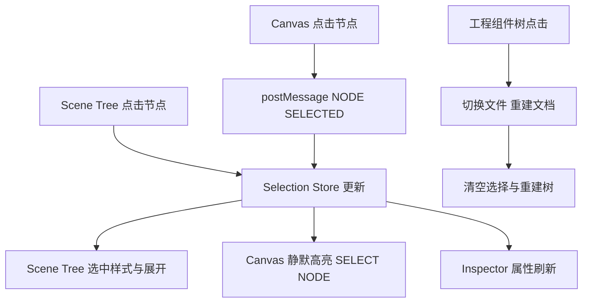

# P3-A 执行计划：三栏式可视化工作台（Visual Editor V1）

- 日期：2026-11-05
- 需求来源：`dev-docs/planning/P3-A-三栏式可视化工作台需求.md`（V1.0，18 条验收标准 AC-01~18）
- 代码基线：P2 完成后 main（`adf5f34`）
- 执行原则：只改工作台前端（页面 + 选择器 + 新增 editor 模块），Parser/Scene Builder/Renderer/Writer/Diff/MCP 全部不动；零构建 vanilla，沿用「TS 模块导出脚本字符串、服务端拼装」的既有模式（同 `selectorScript()`）。

---

## 一、现状盘点（代码事实，执行前已核实）

### 1.1 涉及文件现状

| 文件 | 现状 | P3-A 处理 |
|---|---|---|
| `src/server/index-html.ts` | 导出 `indexHtml` 模板字符串（两栏：左搜索列表 / 右 crumb+关系面板+iframe），内联全部 JS | 重写为三栏 editor 页面，页面拆分为 editor 模块拼装 |
| `src/server/server.ts` | `/` 路由返回 `indexHtml`；`/view` 返回完整 HTML（含 `#egret-info` + selectorScript）；`/view?bare=1` 无脚本（P2-E 回写输入） | `/` 改用 editor 页面；`/view` 不动；`/api/scene` 增补一个字段（见 3.4） |
| `src/selection/component-selector.ts` | 点击 `.egret-node` 高亮 + console 输出 + `#egret-info` 显示；Escape 取消；`?focus=` 初始定位。无父子通信 | 升级：增加 postMessage 双向通信（保留既有行为） |
| `src/scene/scene-json.ts` | `toSceneJson` 输出 `{file, className, stage, diagnostics, nodes}`；`nodes` = 根 Skin 的直接子节点（**根 Skin 自身不在内**） | 增补顶层 `rootKey` 字段（见 3.4）；其余不动 |

### 1.2 Scene JSON 节点字段（已核实，字段名与 SceneNode 不同）

```text
节点: { type, id, name, path(instancePath), key(stableKey), bounds{x,y,width,height},
        attrs, native{tag,className,attributes,states,includeIn,excludeIn},
        asset{kind:"file"|"frame", file, frame?} | null,
        component, srcFile, simulated, layout, unsupported, children[] }
```

- `component / srcFile / simulated / layout / unsupported` 为空时整个字段缺省（JSON.stringify 剔除 undefined）。
- 顶层：`{ file, className, stage{width,height}, diagnostics[], nodes[] }`，无根 Skin 节点。

### 1.3 渲染 DOM 约定（已核实）

- `.egret-stage`：舞台根 div，携带 `data-egret-key`（= 根 Skin 的 stableKey）、`data-egret-attrs`、`data-egret-layout`。
- `.egret-node`：可点击语义节点，携带 `data-egret-id/name/type/path/key/src/tag/class/attrs`（+ 可选 component/component-kind/simulated/layout）。
- `.egret-skin-wrap`：内联皮肤包装层，携带语义 data 属性但**不是** `.egret-node`（点击其内部子节点会选中外层按钮；本身可被 `[data-egret-key=]` 查询到）。
- 位图数字的位片 span：无 data 属性（装饰），点击会命中外层 bitmapnumber div。
- `.egret-selected`：已有样式（金色 outline + box-shadow），直接复用为选中态；悬停另用 `.egret-hover` 类区分。

### 1.4 合成节点在 Scene JSON 中的形态（已核实）

- List 静态 item 包装层：`native.tag === "List:itemRenderer"`、`simulated === true`、key 形如 `根前缀#路径.i0`；其内容子节点 key 前缀为 item 皮肤文件名。
- 自定义组件展开内容：`srcFile` 指向源皮肤 EXML（相对路径）、`component.identity/kind/skinClass`。
- 这些全部走同一条 `key` 索引，无需特判数据通路，只在展示层打标记。

---

## 二、总体架构

### 2.1 模块结构（沿用 selectorScript 的「脚本字符串」模式，零构建）

```text
src/
├── editor/                      新增：三栏工作台前端（每模块导出脚本/模板字符串）
│   ├── editor-page.ts           页面骨架：三栏 DOM + CSS + 拼装所有脚本，导出 editorPageHtml()
│   ├── editor-state.ts          Selection Store + EditorState + 事件分发（setSelection/clearSelection/subscribe）
│   ├── project-tree.ts          工程组件树：/api/exml 扁平列表 -> 目录树 + 搜索 + 选中态
│   ├── scene-tree.ts            Scene Tree：/api/scene -> key 索引 + 按需展开 + 定位滚动
│   ├── canvas-host.ts           iframe 宿主：postMessage 收发 + 待定位暂存 + 文件切换生命周期
│   ├── canvas-viewport.ts       缩放视口：scale/fit/100% + 滚动平移（P3 阶段实现）
│   └── inspector.ts             Inspector：按节点类型分组渲染属性
├── selection/
│   └── component-selector.ts    升级：postMessage 双向（CANVAS_READY/NODE_SELECTED/NODE_DESELECTED/NODE_NOT_FOUND + SELECT_NODE/DESELECT_NODE）
└── server/
    ├── index-html.ts            删除（被 editor-page.ts 取代）
    └── server.ts                `/` 路由改用 editorPageHtml()；/api/scene 增补 rootKey
```

每个 editor 模块导出形如 `xxxScript(): string` 的脚本字符串；`editor-page.ts` 拼装：

```typescript
export function editorPageHtml(): string {
  return `<!doctype html>...<style>${editorCss()}</style>...
    <script>${stateScript()}${projectTreeScript()}${sceneTreeScript()}${canvasHostScript()}${viewportScript()}${inspectorScript()}</script>...`;
}
```

### 2.2 页面结构

```text
┌────────────────────────────────────────────────────────────────┐
│ #topbar  项目名 | 文件路径 | 舞台尺寸 | zoom- 100% zoom+ Fit     │
├──────────────┬──────────────────────────────────┬──────────────┤
│ #left        │ #canvas-col                      │ #right       │
│ ┌──────────┐ │ ┌──────────────────────────────┐ │ ┌──────────┐ │
│ │#proj-tree│ │ │#rel-bar 组件关系条(可折叠)    │ │ │#inspector│ │
│ │(上,可拖) │ │ ├──────────────────────────────┤ │ │          │ │
│ ├──────────┤ │ │#viewport (overflow:auto)     │ │ │ 分组面板  │ │
│ │#scene-tree│ │ │ └#frame-box(scale 包裹)     │ │ │          │ │
│ │(下)      │ │ │   └iframe#frame(/view)       │ │ └──────────┘ │
│ └──────────┘ │ └──────────────────────────────┘ │              │
└──────────────┴──────────────────────────────────┴──────────────┘
  左右拖拽条 #vsplit1/#vsplit2；左侧上下拖拽条 #hsplit
```

- P2-C 的关系面板（邻域芯片）**保留**，迁移为 `#rel-bar`（画布列顶部可折叠条），逻辑照搬现有 `loadNeighborhood`。
- `#crumb` 合并进 `#topbar` 的文件路径区。

### 2.3 统一状态流



防循环：Selection Store 记录 `source`；来自 tree 的选择派发 `SELECT_NODE`（iframe 静默高亮，不回发）；来自 canvas 的选择只更新 tree/inspector，不再向 iframe 发消息。

---

## 三、关键技术设计

### 3.1 Selection Store（editor-state.ts）

```text
state = {
  file: string | null,            当前 EXML 相对路径
  stableKey: string | null,       当前选中节点（null = 未选中）
  source: "project" | "tree" | "canvas" | null,
  zoom: number,                   画布缩放（P3）
  document: { className, stage, nodes, rootKey, diagnostics, index } | null
}

index: Map<key, { node, parentKey, depth }>   单次构建（见 3.3）
API: setSelection(key, source) / clearSelection(source) / openFile(file) / subscribe(fn)
```

- `subscribe` 回调列表：project-tree（当前文件高亮）、scene-tree（选中/展开/滚动）、canvas-host（发 SELECT_NODE / DESELECT_NODE）、inspector（渲染）、topbar（路径/尺寸刷新）。
- 切换文件：`state.document = null` → 拉取 `/api/scene` → 构建 index → 重建 scene tree → iframe 换 src → 清空选择 → topbar 更新。带请求序号防过期覆盖（连续快速切换时只认最新）。

### 3.2 postMessage 协议（component-selector.ts + canvas-host.ts）

iframe → 父页面（`window.parent.postMessage(msg, location.origin)`，仅当 `window.parent !== window`）：

```text
{ type: "CANVAS_READY" }
{ type: "NODE_SELECTED", stableKey: string }
{ type: "NODE_DESELECTED" }
{ type: "NODE_NOT_FOUND", stableKey: string }
```

父页面 → iframe（`frame.contentWindow.postMessage(msg, location.origin)`）：

```text
{ type: "SELECT_NODE", stableKey: string }
{ type: "DESELECT_NODE" }
```

校验（两侧对称）：

- 父页面收消息：`e.source === frame.contentWindow && e.origin === location.origin`，且 `typeof e.data?.type === "string"`、stableKey 为 string（缺字段丢弃，不报错不崩）。
- iframe 收消息：`e.source === window.parent && e.origin === location.origin`。

iframe 侧行为：

- `CANVAS_READY`：脚本执行完即发送（document 已就绪，img 异步加载不阻塞）。
- 点击 `.egret-node`：沿用现高亮 + info 输出，追加发 `NODE_SELECTED`（读 `dataset.egretKey`）。点击空白（无 `.egret-node` 祖先）：发 `NODE_DESELECTED`。Escape：同空白。
- 收 `SELECT_NODE`：按 `[data-egret-key=...]` 查询；命中则高亮 + `scrollIntoView`（静默，不回发）；未命中回发 `NODE_NOT_FOUND`。皮肤包装层（`.egret-skin-wrap`）可被此查询命中 ✓（见 1.3）。
- 收 `DESELECT_NODE`：清除高亮（静默）。
- `?focus=` 参数行为保留（兼容直开 /view 链接）。
- P2-E 的 `bare=1` 输出不含脚本，回写链路不受影响。

### 3.3 Scene Tree（scene-tree.ts）

- 数据：`/api/scene` 的 `nodes[]` 递归 + 顶层 `rootKey`（见 3.4）合成显示根（根行 = className，key=rootKey，可选中，点击高亮舞台 div）。
- 索引：一次深度遍历构建 `Map<key, {node, parentKey, depth}>`（选择/Inspector 共用，不建两套数据）。
- 渲染：按需展开——只渲染「已展开集合」覆盖路径上的节点；折叠不生成子 DOM。默认展开 depth 0（根行 + 第一层）。
- 行内容：`[类型图标] type (name 或 id)`；图标用 1~2 字符文本徽标（G/I/L/B/S/N/A，无 emoji，零资源依赖）；标记徽章：`展开`（srcFile 存在且 ≠ 当前文件）、`模拟`（simulated）、`合成`（native.tag 形如 `X:Y` 且非真实 EXML 标签，如 `List:itemRenderer`）。
- 点击行：`setSelection(key, "tree")`。
- 定位（canvas 选中时）：index 查 key → 不存在则提示条「节点无法映射到结构树」（不误选其他行，保留现状态）；存在则逐级补 parentKey 进展开集合 → 重渲染 → `scrollIntoView`。
- 文件切换：整树重建，展开集合重置为默认。

### 3.4 /api/scene 增补 rootKey（唯一的底层接口改动）

`toSceneJson` 顶层增加 `rootKey: scene.root.stableKey`（纯增量字段）：

- 用途：树根行身份 + 点击舞台背景时 canvas 发来的根 key 能映射回树。
- 影响面：`server-check` / `mcp-check` 中对 scene JSON 的断言为字段级断言（非全对象 deepEqual），增量字段不破坏；执行时跑 `check:all` 验证，若有整对象断言则同步补字段。

### 3.5 缩放视口（canvas-viewport.ts，P3 阶段）

```text
#viewport { overflow:auto; background:#191919; }
#frame-box { width: stageW*z px; height: stageH*z px; }   /* 布局占位 */
iframe#frame { width: stageW px; height: stageH px;
               transform: scale(z); transform-origin: 0 0; }
```

- z 范围 0.1~4；zoom± 按钮步进 25%（乘法 z*=1.25 / z/=1.25）；100% 重置；Fit = `min((vw-32)/stageW, (vh-32)/stageH)` 并居中。
- 平移 = viewport 原生滚动（满足需求第一阶段要求；空格拖拽留后续）。
- 缩放不进入 iframe 内部（不改渲染结果，AC-16）；CSS transform 不影响 iframe 内点击命中（浏览器自动映射坐标）。
- 文件切换重算 stage 尺寸并触发 Fit。

### 3.6 Inspector（inspector.ts）

- 未选中：空状态文案（需求 6.2 原文）。
- 选中：按 index 取节点，按类型选分组（需求 6.5 表）；分组可折叠（分组标题行点击）。
- 字段直取 Scene JSON（**禁止**从 DOM/CSS 反推）：
  - Basic：type/name/id/key/path/srcFile/component(JSON)；key/srcFile 旁给「复制」按钮（navigator.clipboard）。
  - Transform：**两栏对照**——原始（attrs.x/y/width/height，仅存在时显示）与计算（bounds.*）；不存在显示 `—`；绝不把 bounds 伪装成原始属性。
  - Layout：attrs 中 left/right/top/bottom/horizontalCenter/verticalCenter/percentWidth/percentHeight 存在才显示；`layout` 对象（className+attrs）单独一行 JSON。
  - Image：attrs.source/scale9Grid/fillMode + asset（kind/file/frame）；asset 为 null 且有 source → 显示「资源未解析」诊断（不静默）。
  - Text：attrs 中 text/size/textColor/bold/italic/textAlign/verticalAlign/strokeColor/stroke/lineSpacing 存在才显示；颜色值（0xRRGGBB）显示色块 + 原值。
  - Component：component.identity/kind/skinClass + srcFile + 展开标记（srcFile≠当前文件）+ simulated。
  - Advanced：attrs 完整 JSON（`<pre>` 折叠）。
  - Diagnostics：unsupported[]（若有）+ 文档级 diagnostics 中 nodeId 匹配当前 id/name 的条目。
- 布尔显示 true/false；空值 `—`；长文本换行。

### 3.7 工程组件树（project-tree.ts）

- 数据：`/api/exml`（1151 条扁平 `file` 列表）→ 前端按 `/` 构建目录树；目录行展示子项计数；文件行展示文件名 + hover 提示全路径（title 属性）+ 根 class 不拉取（V1 树内不显示 class，搜索模式复用 `/api/ui-assets` 结果列表形态切换）。
- 搜索：沿用现有三模式（file/class/component → `/api/ui-assets`），命中时树区域切换为结果平铺列表（同 P2-C 行样式），清空恢复目录树。
- 点击文件：`openFile(file)`；当前文件行高亮；「定位当前文件」按钮：展开其目录链并滚动。
- 性能：1151 行一次性渲染 DOM 可承受（每行一个 div，无嵌套组件），首屏目录默认折叠到第一级；需求 11.1 的「不一次性渲染全部」以「目录折叠=不渲染子级」满足。

---

## 四、子阶段执行计划

> 每阶段收尾：`npx tsc --noEmit` + 相关检查 + 真实工程浏览器验证 + 独立提交。

### P0：三栏布局 + 只读展示（对应 AC-01~05、AC-14 部分）

任务：

1. 新建 `src/editor/editor-page.ts`：三栏骨架 + CSS + 顶部工具栏 + 三条拖拽分隔条（`#vsplit1/#vsplit2/#hsplit`，mousedown 拖拽改 CSS 变量宽度/高度，localStorage 记忆）。
2. `src/editor/project-tree.ts`：目录树 + 搜索 + 打开文件。
3. `src/editor/scene-tree.ts`（只读版）：拉 `/api/scene` → 根行 + nodes 递归渲染 + 展开/折叠 + 模拟/展开/合成标记。
4. `toSceneJson` 增补 `rootKey`（scene-json.ts 一行 + server-check 断言补充）。
5. `src/editor/canvas-host.ts`（基础版）：iframe 加载 `/view?file=` + `#rel-bar` 关系条迁移。
6. `src/editor/inspector.ts`：仅空状态。
7. `server.ts` `/` 路由改 `editorPageHtml()`；删除 `index-html.ts`（server-check 中涉及 `/` 页面的断言同步改）。

验收（浏览器 + chrome-use 快验）：三栏显示、目录浏览、点击文件 Canvas 渲染、Scene Tree 展示、Inspector 空态、拖拽调宽高、`check:all` 全绿（含 exml-writer round-trip 回归 = AC-16/17）。

### P1：双向选择（对应 AC-06/07/10/11/12/13/14）

任务：

1. `src/editor/editor-state.ts`：Selection Store + subscribe + 文档加载（请求序号防过期）。
2. `component-selector.ts` 升级：postMessage 协议全套（3.2）。
3. `canvas-host.ts`：收发消息 + 待定位暂存（iframe 未 READY 时排队，READY 后补发）+ 文件切换清理。
4. `scene-tree.ts`：点击选中 → 静默高亮 canvas；收 NODE_SELECTED → 展开/滚动/选中；NODE_NOT_FOUND → 树顶提示条。
5. 防循环：source 字段贯通三条入口。

验收（真实工程 HometownRebateView）：Tree 点击任意节点 Canvas 高亮；Canvas 点击（含 stage 背景、位图数字、item 内部节点、内联皮肤子节点）Tree 定位；切换文件旧选择清除；`?focus=` 兼容不破坏。

### P2：Inspector 属性展示（对应 AC-08/09/11）

任务：`inspector.ts` 全量分组（3.6 设计）+ index 共用 + 类型分发。

验收：Group/Image/Label/Button/Scroller/BitmapNumber/Animation 各类型抽查（HometownRebateView + GameDisbandVoteSkin + List 页面）；原始属性与计算 bounds 对照明确；模拟节点标记可见；资源未解析有诊断。

### P3：Canvas 体验（对应 AC-15）

任务：`canvas-viewport.ts`（3.5）+ iframe 侧悬停（`.egret-hover` 样式 + 名称/类型/宽高浮标，iframe 内实现无坐标换算）+ topbar 缩放控件接通。

验收：Fit/±/100% 正常；缩放后双向选择不受影响；悬停与选中视觉区分。

---

## 五、测试与验收

### 5.1 自动化（每阶段跑，最终全跑）

```bash
npx tsc --noEmit
npm run check:all        # 9 套：parser/render/server/mcp/assets/graph/diff/writer + tsc
```

- `server-check` 增补：`/` 返回三栏标记（#left/#canvas-col/#right）；`/api/scene` 含 rootKey；`/view?bare=1` 不含 selectorScript（既有回归）。
- AC-16/17 由 render-check + exml-writer-check 既有断言保证（渲染器与回写零改动）。

### 5.2 浏览器验收（最终，chrome-use + MCP 读图，流程同 P2 收尾）

| 用例 | 操作 | 断言 |
|---|---|---|
| TC-01 | 打开工作台→展开目录→搜索→点击 HometownRebateView | Canvas 加载、Scene Tree 更新（111 节点树） |
| TC-02 | Scene Tree 点击 Label/位图数字节点 | Canvas 高亮对应元素、Inspector 显示属性 |
| TC-03 | Canvas 点击 Image/按钮 | Tree 自动展开定位、Inspector 同步 |
| TC-04 | 展开自定义组件子树选中内部节点 | srcFile/instancePath/key 正确（ArtNumber 数字位、ItemRender 内部） |
| TC-05 | List 页面选中模拟 item | 「模拟」标记、不误映射源节点 |
| TC-06 | 选中节点后切换文件 | 旧选择清除、新文档重建 |
| TC-07 | check:all + tsc | 全绿 |

- 每用例截图存 `dev-docs/progress-result/p3a-browser-*.png`，MCP 读图复核（同 P2-E 收尾流程）。
- 缩放（AC-15）在 TC-03 基础上：Fit → 放大 → 点击仍正确。

### 5.3 验收标准对照

AC-01~05 → P0；AC-06/07/10/11/12/13/14 → P1；AC-08/09 → P2；AC-15 → P3；AC-16/17/18 → 每阶段回归（渲染器/回写零改动的结构性保证 + check:all）。

---

## 六、风险与边界（明示）

| 风险 | 对策 |
|---|---|
| /api/scene rootKey 增量字段破坏既有断言 | 执行时先跑 check:all 定位，断言为字段级预期不破坏；若破坏同步补 |
| stableKey 与 DOM data-egret-key 不一致（理论不存在） | selector 侧只信 DOM key，树侧只信 JSON key；不匹配走 NODE_NOT_FOUND + 树提示，不误选 |
| 皮肤包装层（.egret-skin-wrap）非 .egret-node，canvas 点击选中父按钮 | 设计内：包装层透明无视觉，Tree 行仍可选中它并高亮（data-egret-key 查询命中） |
| 位图数字位片 span 无 data 属性 | 点击命中外层 bitmapnumber div（closest 特性），Tree 选中即数字组件本体 |
| 大文档 Scene Tree 卡顿 | V1 按需展开 + 折叠不建 DOM；实测 HometownRebateView 111 节点无压力；数千节点再虚拟化（需求十一章预留） |
| iframe img 未加载完即选中 | 选择/高亮与图片加载无关（DOM 查询）；不等待 |
| postMessage 被其他脚本伪造 | origin + source 双校验，字段类型运行时验证 |
| 拖拽分隔条与 iframe 抢鼠标 | 拖拽条 mousedown 时给 body 加 overlay 捕获，iframe pointer-events 暂关 |

---

## 七、交付物清单

1. 三栏工作台页面（`src/editor/*` 七模块 + `server.ts` 接线）。
2. 升级版 `component-selector.ts`（双向通信）。
3. `/api/scene` rootKey 增量字段。
4. `server-check` 增补断言。
5. 浏览器验收记录（TC-01~07 + 截图 + MCP 读图复核）。
6. `dev-docs/progress/执行进度.md` 更新 + `dev-docs/progress-result/P3-A-执行报告.md`。
7. 每子阶段独立提交，最终 push 后 GitHub CI 全绿。

---

## 八、引用

- 需求文档：`dev-docs/planning/P3-A-三栏式可视化工作台需求.md`
- P2-C 工作台实现：`src/server/index-html.ts`（本阶段改造对象）
- P2-E 语义约定（bare 输出不受影响的依据）：`dev-docs/progress-result/P2-E-执行报告.md`
- 既有选择器与 focus 参数：`src/selection/component-selector.ts`
- Scene JSON 字段事实：`src/scene/scene-json.ts`（执行前已实测 /api/scene 输出核实）
